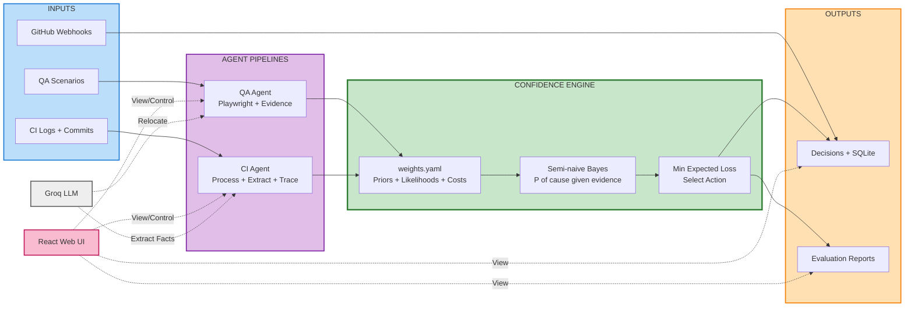

# TriageCore

A shared decision engine for browser-test recovery and CI failure triage. QA and CI agents collect
different evidence, then use the same **ConfidenceEngine** to diagnose likely causes and choose an
action or escalate to a person.

Final-year project at FAST School of Computing.

## How it works

The engine groups observed signals, estimates cause probabilities with semi-naive Bayes, then
chooses the action with the lowest expected loss for the configured risk tier. Missing evidence is
left out, and escalation is always available. Groq proposes selectors or extracts CI facts; it does
not make the decision.

## Architecture



## Project status

| Area | Current scope |
|---|---|
| QA | Runs browser scenarios, gathers post-click evidence, and may suggest a selector patch. It never applies the patch automatically. |
| CI | Analyzes saved fixture and reviewed historical cases. Logs are processed locally; the app does not fetch live GitHub logs. |
| Webhooks | Verifies failed-run webhook signatures and stores accepted jobs. Stored jobs are not processed live. |
| Evaluation | QA results are from a small project-built suite. CI evaluation and probability calibration remain preliminary; neither demonstrates real-world effectiveness. |

CI calibration is waiting on enough human-reviewed flaky cases for a useful training and holdout split. See the [project plan](docs/plan.md) and [progress](docs/progress.md) for current limitations.

## Quickstart

Requirements: Python 3.10+, Node.js 20.19+ or 22.12+, npm, and a Groq API key for selector
relocation and CI fact extraction. `GITHUB_WEBHOOK_SECRET` is only needed to accept webhooks.

```bash
cp .env.example .env      # set GROQ_API_KEY
make setup                # venv, Python deps, Chromium, frontend deps
make test                 # run the test suite
make api                  # terminal 1: API at http://localhost:8000
make ui                   # terminal 2: UI at http://localhost:5173
```

The API and UI run in separate terminals. Without `GROQ_API_KEY`, selector relocation and fact
extraction cannot run; affected cases fail safe by escalating.

Useful checks: `make test-engine`, `make lint`, `make weights`, `make sensitivity`, `make eval`,
and `make verify`.

## What you can try

- **QA Engine:** run a scenario in Chromium and inspect evidence, diagnosis, and action costs.
- **CI Engine:** search saved fixture and reviewed historical cases, then analyze a selected case.
- **Evaluation:** compare QA decisions against the included baselines.

## API

The API is available at `http://localhost:8000`; interactive OpenAPI docs are at `/docs`.

| Route | Purpose |
|---|---|
| `GET /health` | Service health |
| `GET /api/qa/scenarios`, `POST /api/qa/run` | List scenarios and run one in Chromium |
| `POST /api/qa/evaluate`, `GET /api/qa/evaluation/latest` | Run or view the QA evaluation |
| `GET /api/ci/cases`, `POST /api/ci/run` | List and analyze saved CI cases |
| `GET /api/ci/evaluation/latest` | View the latest saved CI evaluation report |
| `POST /api/ci/webhook` | Verify and store a failed GitHub Actions run; requires `GITHUB_WEBHOOK_SECRET` |

The API has no active authentication. Keep it on localhost. Webhooks require a valid
`X-Hub-Signature-256` signature.

## Documentation

- [Architecture notes](.github/modernize/assessment/engines/facts/architecture-diagram.md) · [Project brief](docs/brief.md) · [Plan](docs/plan.md) · [Specification](docs/spec.md)
- [Engine contract](docs/contracts/engine_io.md) · [QA evidence](docs/contracts/raw_signals.md) · [CI evidence](docs/contracts/ci_signals.md) · [Architecture decisions](docs/adr/)
- [Contributing](docs/contributing.md) · [Troubleshooting](docs/troubleshooting.md) · [Project progress](docs/progress.md)
